# ARCHITECTURE — Fuel Supply Intelligence & Resilience Platform

| | |
|---|---|
| **Status** | v1.0 — implements `FINAL_SYSTEM_DESIGN.md` (decision IDs `D1…D22` refer to it) |
| **Format** | Mermaid (renders on GitHub, VS Code with a Mermaid extension, and most Markdown viewers) |
| **Reading order** | 1 Context → 2 Containers → 3 Deployment → 4 Components → 5 Use cases → 6 Domain → 7 Lifecycles → 8 Request paths (sequences) → 9 Data → 10 Frontend → 11 Observability → 12 Delivery |

Every section ends with **Decisions** (what was chosen here and why) so a diagram never appears without its rationale.

---

## 1. System context (C4 level 1)

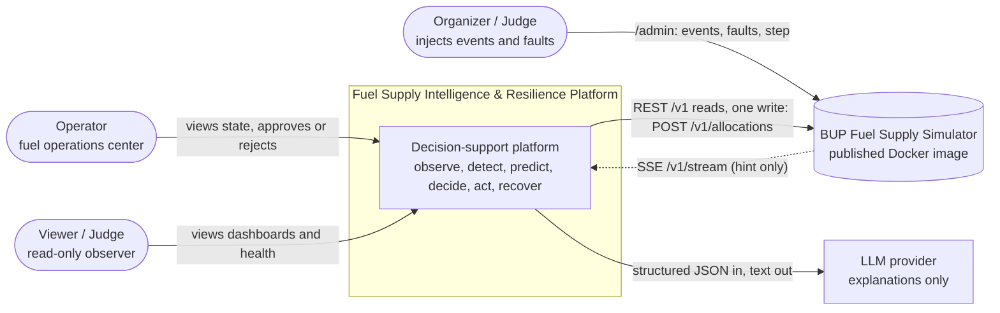

**Decisions**
- The simulator is the *only* source of world state and the *only* sink for actions (F1, F3). We never read its database or modify it.
- Organizers talk to the simulator's `/admin` directly; our platform does **not** depend on `/admin` (a dev-only passthrough exists for rehearsal).
- The LLM sits outside the decision path (D11): it receives already-computed structured results.

---

## 2. Containers (C4 level 2)

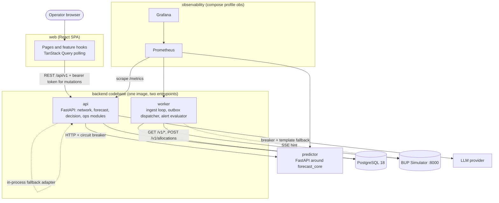

**Decisions**
- **D1 hybrid:** `api` and `worker` share a codebase and image (one set of domain code), but run as separate processes in compose so ingestion never blocks request handling.
- **`api` never calls the simulator for reads.** It serves Postgres read models, so the dashboard keeps working when the simulator is down (last-known-good).
- **`predictor` is the one real network boundary** because the brief lists "prediction service unavailable" as a surprise event (F9). The dashed self-arrow is the in-process fallback adapter built from the same `forecast_core` library.
- Mutating calls go through `api` → outbox → `worker`; the browser never talks to the simulator.

---

## 3. Deployment views

### 3.1 Canonical runtime — `docker compose up`

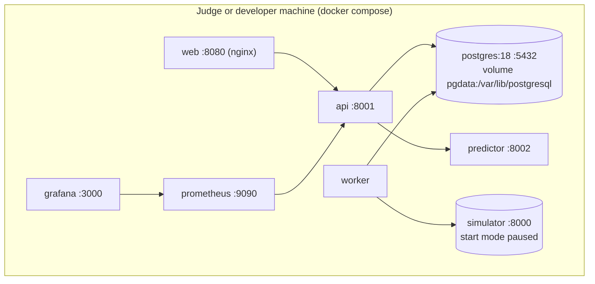

### 3.2 Cloud showcase — Vercel + Render

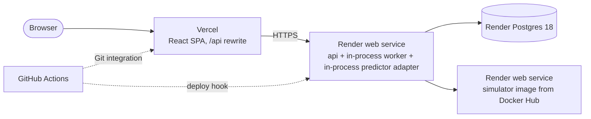

**Decisions**
- **Compose is canonical** (F11): judges run our submission against their own published simulator, so `SIMULATOR_BASE_URL` is the only coupling.
- **Cloud simplifications forced by pricing (verified 2026 sources):** free Render web services sleep after 15 min idle and share ~750 instance-hours; background workers have no free tier; free Postgres expires after 30 days. Therefore in cloud the worker and predictor adapter run in-process (`RUN_WORKER_IN_PROCESS=true`), and the separate predictor service is demonstrated in compose. Paying ~$14/mo restores the full topology in cloud.
- Postgres volume is mounted at `/var/lib/postgresql` for the 18 image (⚠ confirm against image docs).
- `/admin` of a publicly hosted simulator is unauthenticated: restrict by obscure URL/IP or keep cloud fault-injection off.

---

## 4. Backend components

### 4.1 Module and layer map

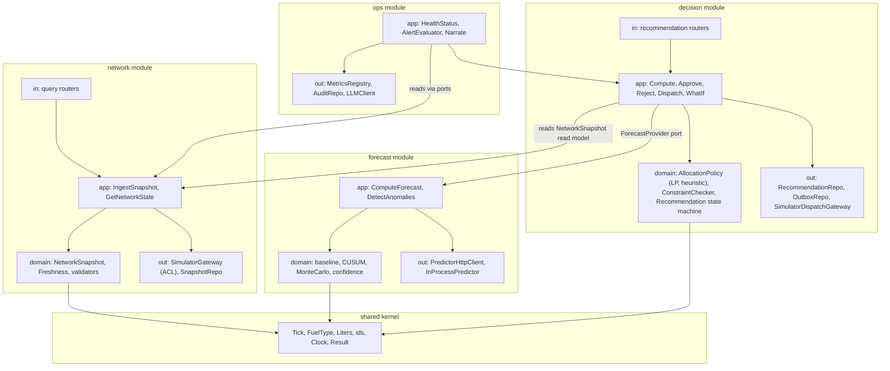

### 4.2 Dependency rules (enforced by `import-linter`)

| Rule | Why |
|---|---|
| `domain` imports nothing from FastAPI, SQLAlchemy, httpx | Pure, fast unit tests; hypothesis property tests |
| `application` depends on `domain` and **ports** only | Use cases are testable with in-memory fakes |
| `adapters` implement ports; only the composition root wires them | No hidden globals (singleton *lifetime*, not Singleton pattern) |
| A module may use another module only through its published port or read model | Keeps ownership boundaries for a 9-person team |

**Decisions**
- **DDD-lite + Clean (D3):** four bounded contexts with a shared kernel; no aggregates-with-events, no event sourcing — the domain is small and fully specified.
- **Behavior-first core (D4):** `domain` functions are written and tested before any table exists; adapters are generated from the simulator contract.
- **Strategy for policies (D10/D22):** `AllocationPolicy` has `LpPolicy`, `PriorityHeuristicPolicy`, `FallbackPolicy`; the choice is configuration, not control flow.

---

## 5. Use cases

### 5.1 Actors and use cases

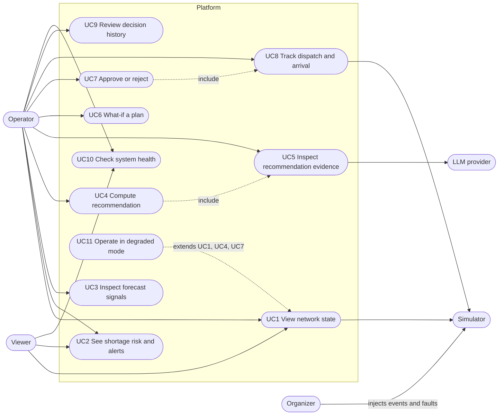

### 5.2 Use-case table

| ID | Use case | Actor | Precondition | Main flow | Alternate / failure |
|---|---|---|---|---|---|
| UC1 | View network state | Operator, Viewer | ≥ 1 valid snapshot | SPA polls `/network/state` | Simulator down → last-known-good + `STALE` banner |
| UC2 | See shortage risk | Operator, Viewer | forecasts computed | Risk list ranked by `p_stockout`, time-to-stockout | Predictor down → fallback forecast, flagged |
| UC3 | Inspect forecast | Operator | UC2 | Demand curve vs baseline, CUSUM signal, uncertainty band | — |
| UC4 | Compute recommendation | Operator | fresh snapshot | Policy runs → items, impact, alternatives, constraints, confidence | LP fails → heuristic; low confidence → `review_required` |
| UC5 | Inspect evidence | Operator | recommendation exists | Open panel: signals, constraints, alternatives, narrative | LLM down → template narrative |
| UC6 | What-if | Operator | snapshot | Re-run forward model with edited plan → risk before/after | — |
| UC7 | Approve / reject | Operator (token) | status PROPOSED, snapshot LIVE | Decision + outbox in one transaction | Stale data → approvals disabled; expired → re-plan |
| UC8 | Track dispatch | Operator | APPROVED | Outbox → simulator → IN_TRANSIT → ARRIVED | 409 permanent → FAILED + re-plan; 503 → retry |
| UC9 | Decision history | Operator | — | Audit list with who/when/why | — |
| UC10 | System health | Operator, Viewer | — | Component status, p95, error rate, breaker states | — |
| UC11 | Degraded operation | Operator | any dependency failure | Banners explain what is limited | See resilience matrix |

**Decisions**
- Mutating actions (UC4, UC6 compute, UC7) require the operator token; viewers are read-only (D14).
- UC7 is the *only* path to a simulator write — human review of consequential decisions is structural, not a convention (F10).

---

## 6. Domain model

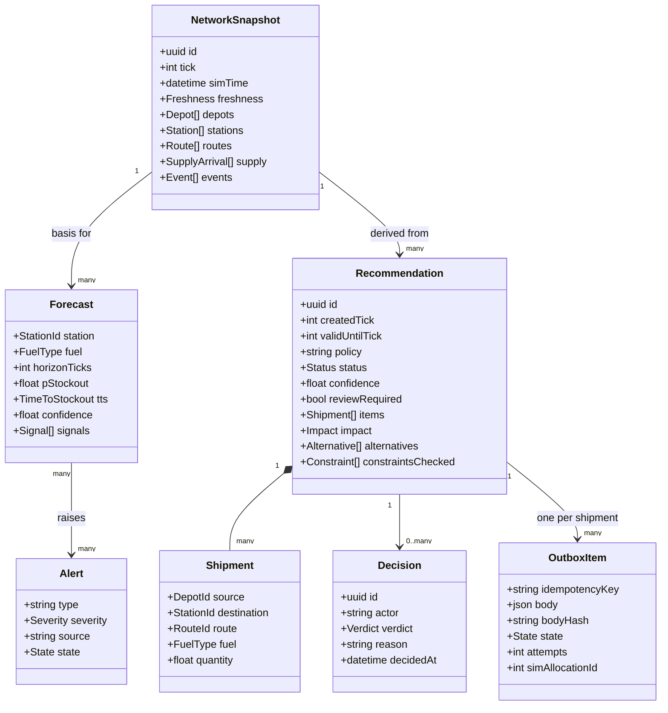

**Invariants (tested as properties):** `inventory` counts only on-hand stock — scheduled/delayed supply and in-transit shipments are separate; every `Shipment.quantity ≤ route.max_shipment`; `OutboxItem.body` is immutable after insert (a changed body requires a new key); a `Recommendation` cannot be approved after `validUntilTick` or on a non-`LIVE` snapshot.

---

## 7. Lifecycles and state machines

### 7.1 Recommendation

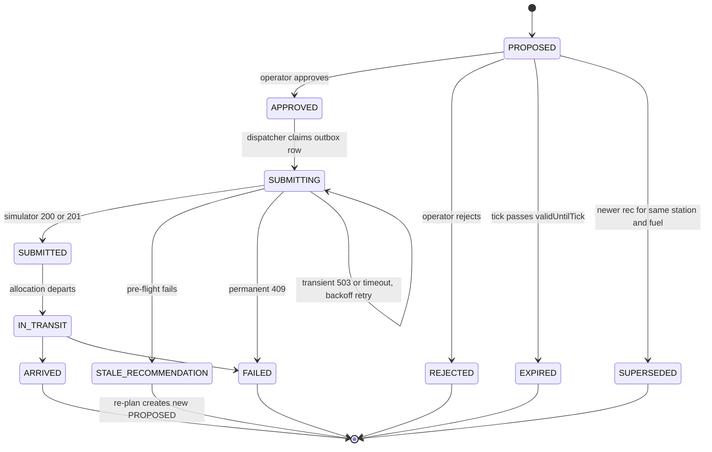

### 7.2 Circuit breaker (per dependency: simulator, predictor, LLM)

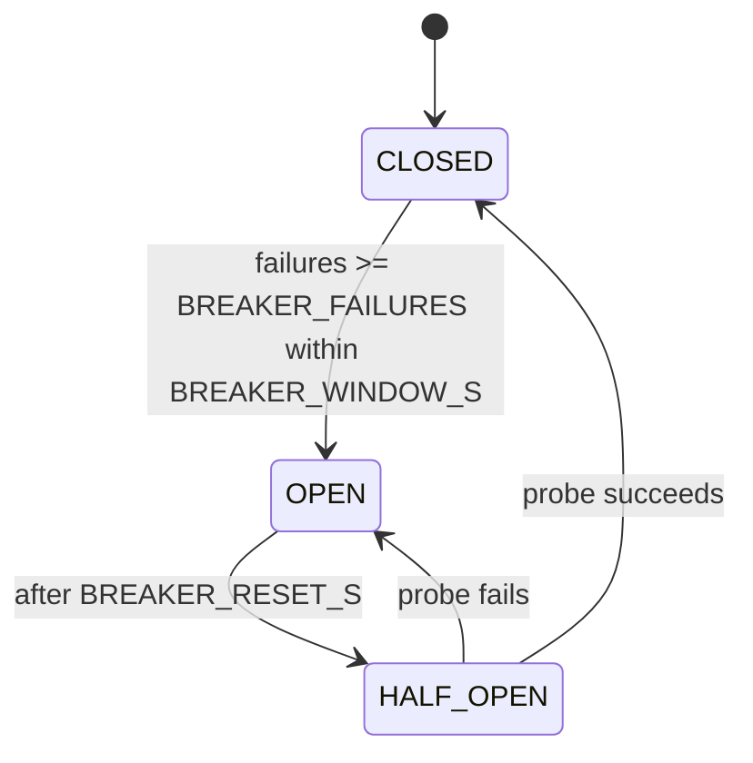

### 7.3 Snapshot freshness

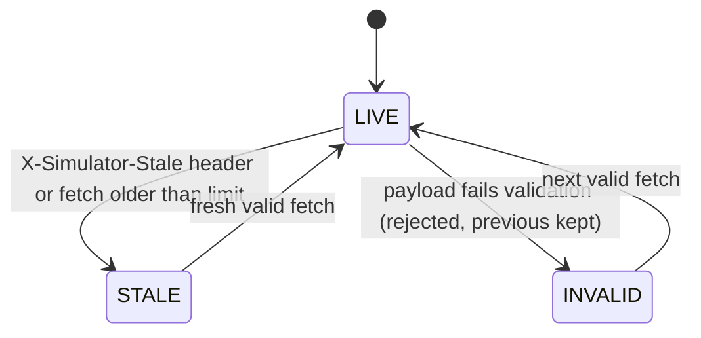

**Decisions**
- A state machine makes illegal transitions impossible and gives the audit trail for free (D22).
- `STALE` snapshots **disable approve/dispatch**; reads remain available (graceful degradation).
- `SUBMITTING → SUBMITTING` is safe only because of the simulator's idempotency rule: same key + same body replays (accept 200 **or** 201); a changed body would 409.

---

## 8. How a request travels — sequences

### 8.1 Middleware pipeline for any API request

```mermaid
flowchart LR
  A["Browser"] --> B["Vercel rewrite /api"]
  B --> C["FastAPI: request-id + structured log context"]
  C --> D["CORS allow-list"]
  D --> E["Rate limit"]
  E --> F["Auth: bearer token for mutations"]
  F --> G["Pydantic request validation"]
  G --> H["Router (adapter in)"]
  H --> I["Use case (application)"]
  I --> J["Repository / port (adapter out)"]
  J --> K["Response model + problem+json on error"]
  K --> L["Metrics: rate, latency histogram, errors"]
  L --> A
```

| Hop | Responsibility | Failure → response |
|---|---|---|
| request-id/log | correlate logs and traces | — |
| rate limit | protect under traffic spike | 429 problem+json |
| auth | operator token on mutating routes | 401/403 |
| validation | reject malformed input | 422 problem+json |
| use case | business rules | domain error → 409/422 with `code` |
| repository/port | DB or dependency call with timeout/breaker | 503 with degraded hint |
| metrics | feed Prometheus + status page | — |

### 8.2 Dashboard read (never touches the simulator)

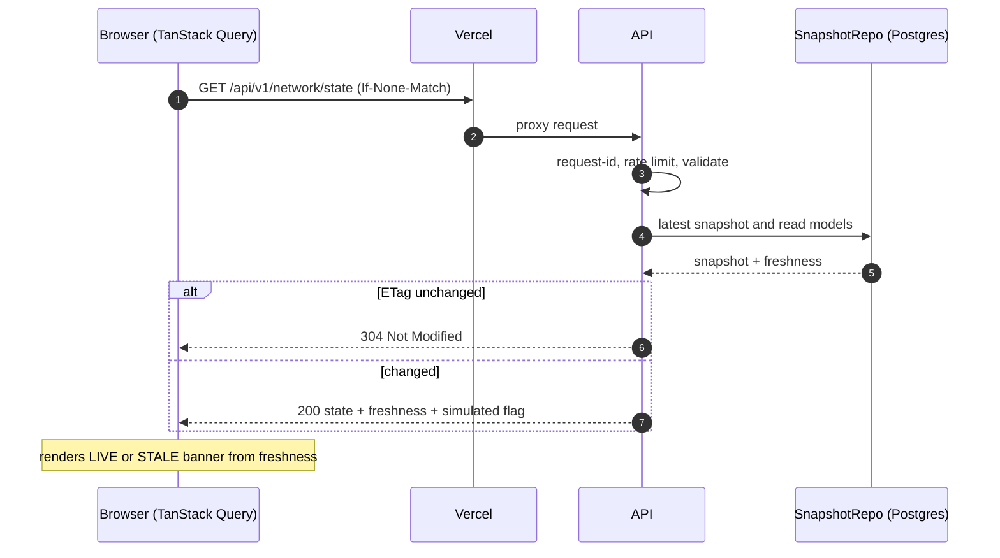

### 8.3 Ingestion cycle (worker, wall-clock paced)

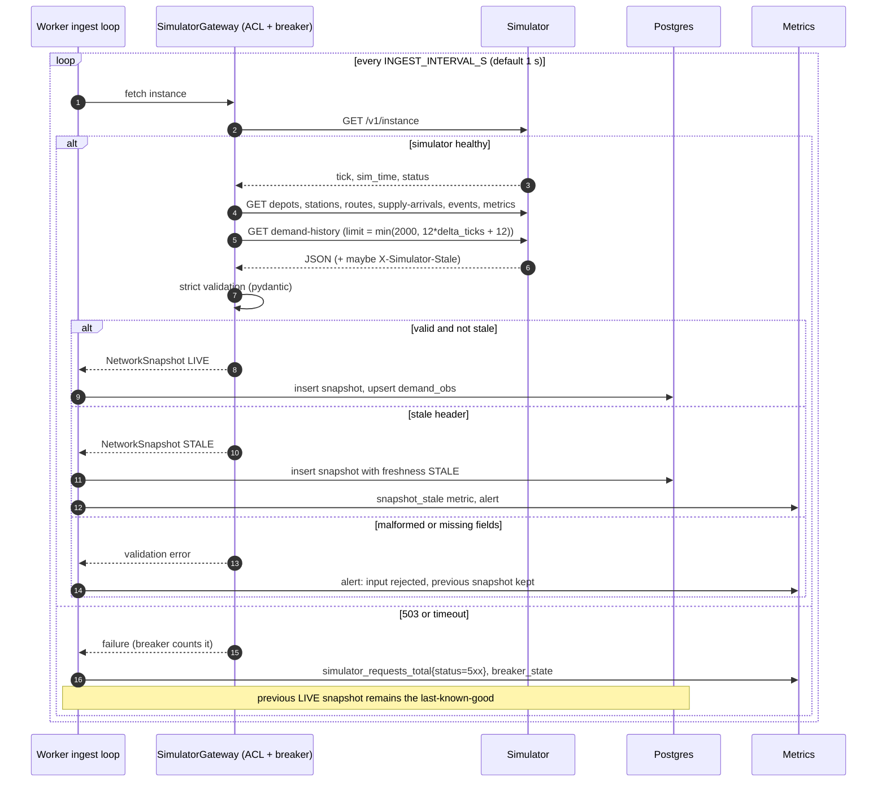

### 8.4 Compute a recommendation (predictor boundary + fallback)

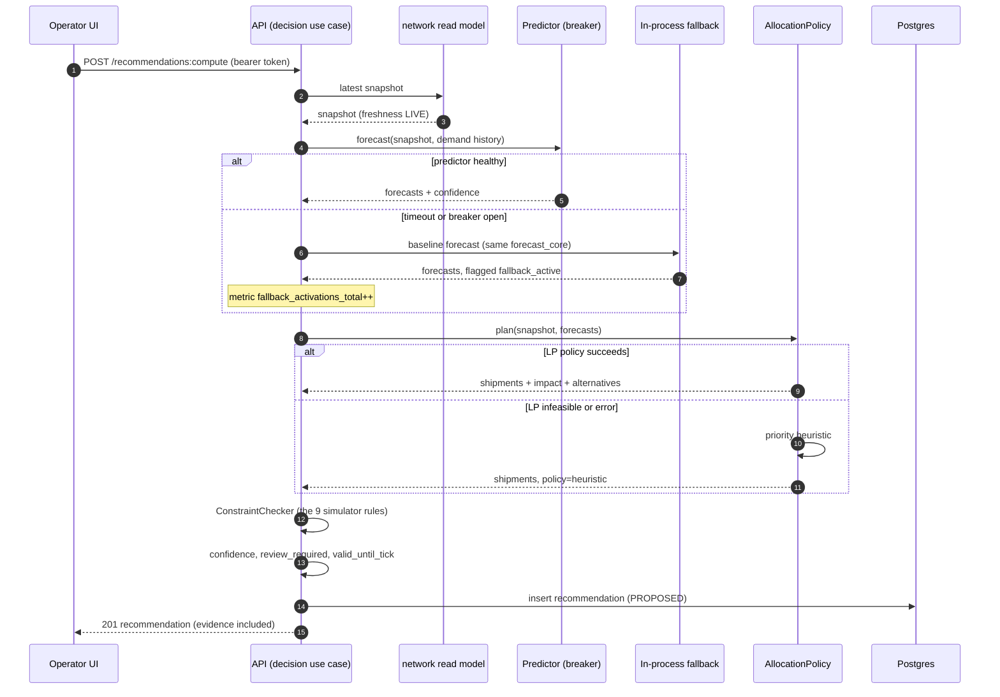

### 8.5 Approve → outbox → simulator (the reliable write)

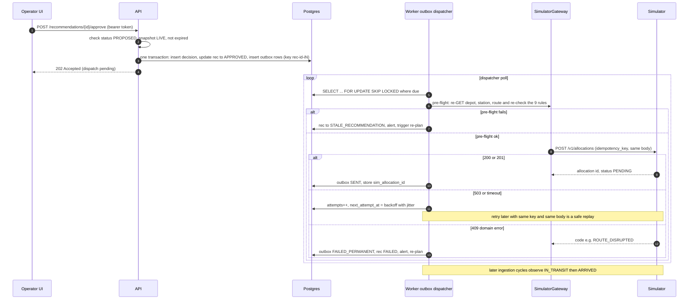

### 8.6 Crisis: demand spike detected → adapted recommendation

```mermaid
sequenceDiagram
  autonumber
  participant ORG as Organizer
  participant S as Simulator
  participant W as Worker
  participant FC as forecast_core
  participant AL as Alert evaluator
  participant UI as Operator UI
  participant A as API
  ORG->>S: POST /admin/events demand_spike x1.8 region-dhaka
  S-->>S: station demand_multiplier rises while event ACTIVE
  loop next ingestion cycles
    W->>S: GET stations, demand-history
    W->>FC: update demand ratio (EWMA) and CUSUM
    FC-->>W: shift detected, estimated multiplier, new p_stockout
  end
  W->>AL: p_stockout above threshold
  AL-->>UI: alert: station, fuel, time-to-stockout, signals
  UI->>A: compute recommendation
  A-->>UI: cross-checked plan, impact 72% to 19%, alternatives
  UI->>A: approve
  Note over A,S: continues as 8.5, then recovery is visible when the event resolves
```

### 8.7 Predictor outage

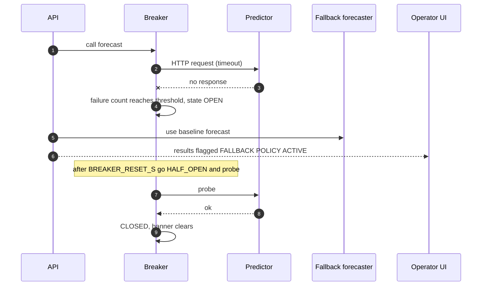

### 8.8 Explanation (LLM outside the decision path)

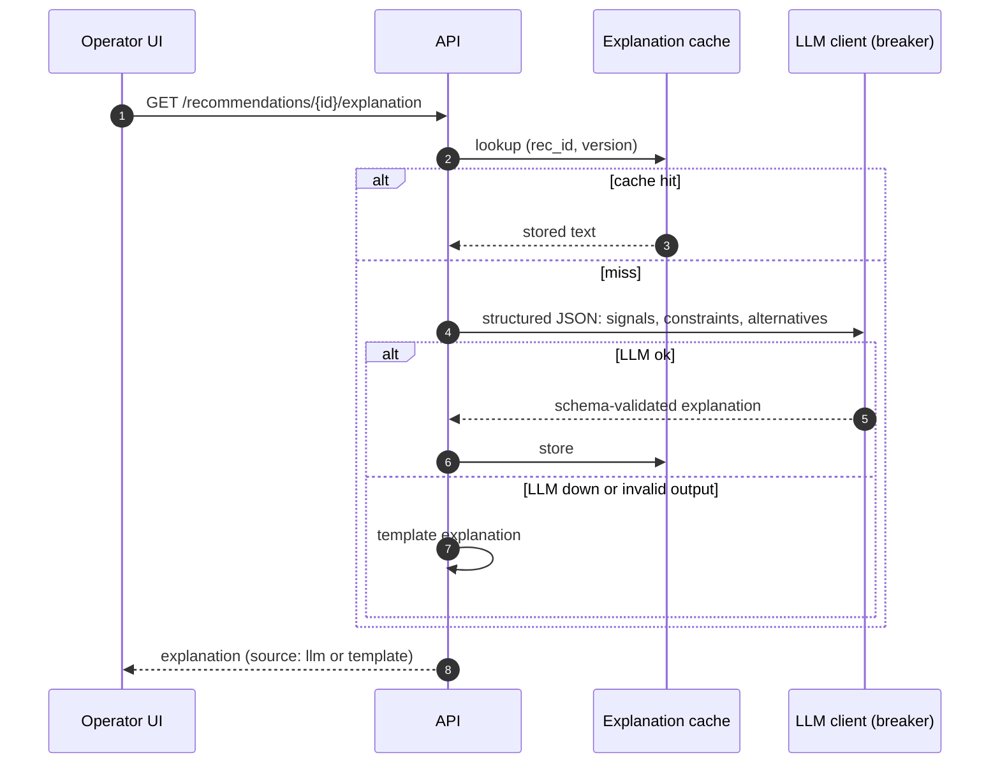

**Decisions across §8**
- **Reads never block on the simulator** (8.2) — CQRS-lite read models; this is what makes the dashboard degradable.
- **Wall-clock ingestion with backfill** (8.3) because the simulator may run at 8–15 ticks/s; per-tick ingestion would be both impossible and unnecessary.
- **Outbox over inline POST** (8.5): approve and "to-send" are one DB transaction; the dispatcher is at-least-once and the simulator's idempotency makes redelivery safe. Pre-flight prevents sending a plan that became invalid while waiting.
- **Fallback is a code path, not a toggle** (8.4, 8.7): the in-process forecaster uses the same `forecast_core`, so degraded results are coherent, just less refined.
- **Human approval is mandatory** (8.5): there is no route from compute to dispatch without a `Decision` row.

---

## 9. Data architecture

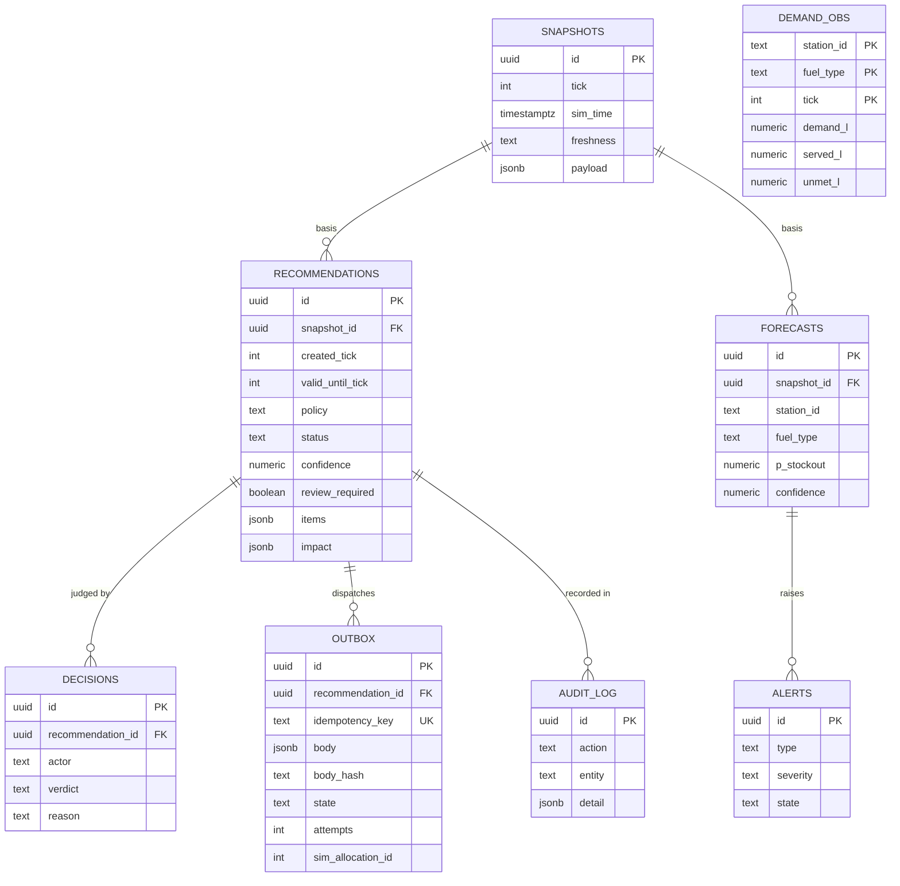

**Decisions**
- **PostgreSQL 18 (D5):** one transaction covers decision + outbox; `UNIQUE(idempotency_key)` enforces the simulator's idempotency contract locally; `DEFAULT uuidv7()` gives time-ordered keys; partial index `outbox (next_attempt_at) WHERE state='PENDING'` keeps the dispatcher cheap.
- `snapshots.payload` is JSONB (raw validated copy for audit/replay) with the hot fields extracted; `demand_obs` is relational because forecasting needs windowed queries.
- **No Redis (D6):** latest-snapshot read model + in-process TTL cache cover degraded mode.

---

## 10. Frontend architecture

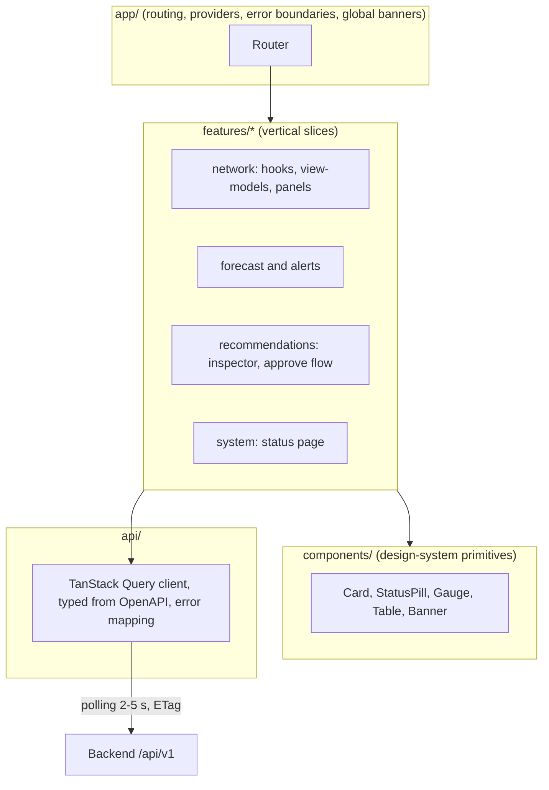

**Decisions**
- **SPA over Next.js (D12):** no SSR need; one fewer runtime on Vercel.
- **Server state in TanStack Query, almost no client state:** the backend is the source of truth; polling with ETag gives near-real-time without WebSocket machinery (D13). SSE is a stretch, connected directly to the API origin because long-lived streams through Vercel rewrites are unverified.
- **Components never call `fetch`;** feature hooks do. View-models are pure functions → unit-testable without a DOM.
- **Banners are first-class:** `LIVE | STALE | FALLBACK ACTIVE | APPROVALS DISABLED` plus a permanent **SIMULATED DATA** tag (F10).

---

## 11. Observability architecture

```mermaid
flowchart LR
  api["api"] -->|"/metrics"| prom["Prometheus"]
  worker["worker"] -->|"/metrics"| prom
  pred["predictor"] -->|"/metrics"| prom
  prom --> graf["Grafana dashboards<br/>Golden signals, Intelligence, Resilience, Dispatch"]
  prom --> rules["Alert rules"]
  rules --> status["In-app system status and alerts"]
  api -->|"JSON logs"| logs["stdout, Docker logs, Render logs"]
  worker -->|"JSON logs"| logs
  api -->|"/health/ready, /system/status"| status
```

| Layer | Signals |
|---|---|
| Application | request rate, latency histogram (p50/p95/p99), error rate |
| Integration | `simulator_requests_total{status}`, `simulator_latency_seconds`, `breaker_state{dep}`, `snapshot_age_seconds` |
| Intelligence | `forecast_abs_error`, `forecast_confidence`, `shortage_alerts_open`, `recommendations_total{policy}`, `fallback_activations_total` |
| Dispatch | `outbox_pending`, `dispatch_failures_total{code}` |
| System | process CPU/memory |
| Logs | structured JSON with `request_id`, `tick`, `rec_id`: decisions, integration failures, recoveries |

**Decision:** Prometheus/Grafana run in compose (`obs` profile) where judges look; in the free cloud tier the same data is surfaced by the in-app status page (running a metrics stack there is impractical).

---

## 12. Delivery architecture (summary — details in `PIPELINE.md`)

```mermaid
flowchart LR
  dev["Feature branch"] --> pr["Pull request"]
  pr --> ci1["Lint, types, import-linter"]
  ci1 --> ci2["Unit tests"]
  ci2 --> ci3["Integration tests<br/>postgres:18 + simulator services"]
  ci3 --> ci4["Build images"]
  ci4 --> prev["Vercel preview"]
  prev --> merge["Merge to main"]
  merge --> e2e["E2E on compose (Playwright)"]
  e2e --> push["Push images (GHCR)"]
  push --> deploy["Render deploy hook + Vercel production"]
  deploy --> smoke["Smoke: /health/ready"]
  smoke -->|"fail"| rb["Rollback to previous deploy"]
  nightly["Nightly"] --> acc["Acceptance suite, k6 load, policy bake-off"]
```

**Decision:** the four test levels map to pipeline stages so a failure points at a class of defect: unit (logic) → integration (contracts with Postgres/simulator) → E2E (user journeys) → acceptance (business outcomes).

---

## 13. Decision traceability

| Requirement (brief) | Where satisfied |
|---|---|
| Operator application | §10, UC1–UC11 |
| Simulator integration | §2, §8.3, §8.5 |
| Intelligence (predict/detect/decide/GenAI) | §4.1 forecast/decision modules, §8.4, §8.8 |
| Explainable decisions | recommendation evidence (§6), UC5 |
| Resilience / graceful degradation | §7.2, §7.3, §8.3, §8.7, resilience matrix in `FINAL_SYSTEM_DESIGN.md` §8 |
| Observability + health | §11, UC10 |
| Deployment (reproducible) | §3.1 compose, §3.2 cloud |
| CI/CD, tests | §12 |
| Load testing | k6 against `/network/state` and `/recommendations:compute` (§12 nightly) |
| Human review of consequential decisions | UC7, §8.5 |
