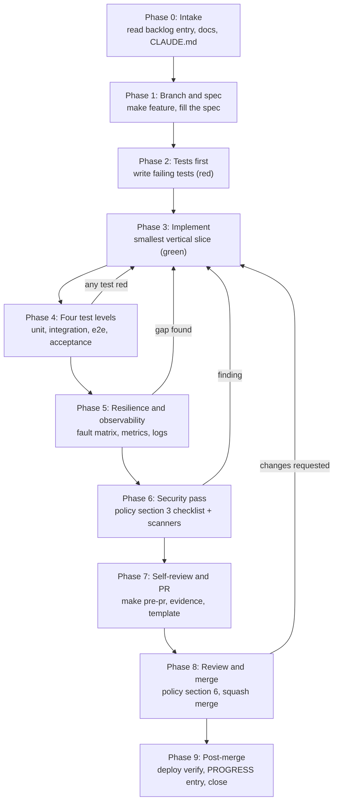

# FEATURE IMPLEMENTATION PLAN — how every feature gets built

| | |
|---|---|
| **Audience** | The coding agent (Claude Code) **and** every human on the team. Same rules for both. |
| **Status** | v1.0 · 2026-11-20 · lives at `docs/process/FEATURE_IMPLEMENTATION_PLAN.md` |
| **Precedence** | `CLAUDE.md` (always-on rules) > this plan > skills (`SKILLS.md`) > habits |
| **Companions** | `SECURITY_AND_REVIEW_POLICY.md` · `PIPELINE.md` · `BACKLOG.md` · `docs/design/*` |
| **Repo layout assumed** | `backend/shared/core` (pure logic + simulator client) · `backend/api` · `backend/worker` · `intel/predictor` · `web/` · `tests/{unit,integration,scenarios,acceptance}` |

**One sentence:** *one feature = one backlog ID = one branch = one spec doc = one PR*, built test-first, proven at four test levels, passed through security and review gates, merged by squash, verified after deploy.

---

## 1. The lifecycle at a glance



A phase is finished only when its **gate** passes. Do not start the next phase early; do not start the next feature until Phase 9 of the current one is done (exception: parallel humans on different features).

---

## 2. Branching and naming (keep it organized)

### 2.1 Branch name
```
<type>/F-<id>-<kebab-feature-name>
```
| Part | Rule | Example |
|---|---|---|
| `type` | `feat` new capability · `fix` bug · `refactor` no behavior change · `chore` tooling/deps/CI · `docs` · `test` · `hotfix` (urgent fix to `main`) | `feat` |
| `F-<id>` | Backlog ID, 3 digits (`F-005`). Every branch has one — create the backlog entry first if it doesn't exist | `F-005` |
| `kebab-feature-name` | lowercase, digits, hyphens; ≤ 6 words; names the *outcome* | `predictor-fallback` |

Valid: `feat/F-005-predictor-fallback`, `fix/F-021-stale-header-ignored`, `chore/F-002-ci-hardening`.
Invalid: `fatima-work`, `feature/predictor`, `feat/predictor_fallback`, `feat/F-5-x`.
`scripts/pre-pr-check.sh` rejects non-conforming branch names.

### 2.2 Create it with the script (never by hand)
```bash
make feature ID=F-005 NAME=predictor-fallback            # TYPE defaults to feat
make feature ID=F-021 NAME=stale-header-ignored TYPE=fix
```
It verifies a clean tree, branches from fresh `origin/main`, refuses duplicates, and commits the spec skeleton `docs/features/F-005-predictor-fallback.md`.

### 2.3 Hygiene rules
- **One feature per branch, one branch per PR.** If you discover unrelated work, open a new backlog entry — do not fold it in.
- **Short-lived:** target < 1 working day, hard limit 2 days. If it grows, split the feature.
- **Sync daily:** `git fetch origin && git rebase origin/main` (feature branches only). Use `git push --force-with-lease` **only** on your own feature branch; never on `main`.
- **Commits:** `type(F-005): imperative summary` (e.g., `feat(F-005): add in-process fallback forecaster`). Small, logical commits; no "wip" on a branch that is in review.
- **PR title** = the squash-commit message: `feat(F-005): predictor fallback with circuit breaker`.
- **Merge = squash**, linear history. The branch is deleted after merge.
- **Parallel agent sessions** on the same machine: use a separate worktree per feature — `git worktree add ../wt-F-005 -b feat/F-005-predictor-fallback origin/main` — so sessions never share a working directory.
- **Tags:** after a sprint's last merge, `git tag sprint-N` on `main`; urgent fixes use `hotfix/F-###-name` with 2 approvals.

---

## 3. Phase-by-phase instructions

### Phase 0 — Intake and understand
**Do**
1. Read: `CLAUDE.md`, the backlog entry (`docs/process/BACKLOG.md#F-###`), the design sections it cites, any related ADRs, and `docs/PROGRESS.md` (latest state).
2. Read the code you will touch (the module and its tests) **before** proposing changes.
3. Restate the feature in one sentence of operator value. List assumptions. If something is ambiguous, pick the simplest option that keeps the acceptance criteria true and write it down (Phase 1, §9) — don't stall.

**Gate:** you can state goal, non-goals, and acceptance criteria without looking; dependencies from the backlog are merged.

### Phase 1 — Branch and spec
**Do**
1. `make feature ID=… NAME=…` (see §2.2).
2. Fill spec sections 1–5: goal/non-goals, acceptance criteria as **Given/When/Then** (each will map to a named test), design notes (modules touched, contracts, time model), failure modes table, observability.
3. Check architecture fit: which of `core`/`api`/`worker`/`predictor`/`web`? Does it respect `.importlinter` (core stays pure; api never imports worker or the simulator client; worker never imports api)? A new service, datastore, or framework ⇒ stop and open an ADR.
4. Contract-first: if it adds/changes an API route or DB column, write the request/response shape or additive SQL in the spec first.

**Gate:** spec committed; every acceptance criterion is testable.

### Phase 2 — Tests first (red)
**Do**
1. For each acceptance criterion, write the failing test at the lowest level that can prove it (see §4). Name tests `test_<behavior>_<condition>`.
2. Run them; confirm they fail **for the right reason** (missing behavior, not a typo).
3. Domain rules get **property tests** (hypothesis) where an invariant exists — e.g., "no generated plan violates any of the simulator's 9 validation rules".

**Gate:** new tests exist and are red; nothing else changed yet.

### Phase 3 — Implement (green)
**Do**
1. Smallest vertical slice that turns the tests green: `core` (pure logic) → `worker`/`api` (adapters) → `web` (UI) — in that order. Pure functions first.
2. Respect the invariants (see §8). Add typed errors rather than swallowing exceptions.
3. Every new external call: **timeout + retry policy + circuit breaker + defined degraded behavior** (resilience contract in the design doc).
4. Config via environment only; add to `.env.example` with a safe placeholder.
5. Run the affected tests after each small step; commit when green.

**Gate:** the Phase 2 tests are green; no unrelated files modified (`git diff --stat` is explainable).

### Phase 4 — Run all four test levels
Run them in this order and **paste real output** into spec §7 (not "passes locally").

| Level | Command | Pass criterion |
|---|---|---|
| 1. Unit | `make test-unit` | all green; new/changed lines covered |
| 2. Integration | `make test-int` (DB/simulator tests need `DATABASE_URL`, `SIM_BASE_URL`) | all green incl. real PostgreSQL 18 / real simulator tests for anything touching persistence or the simulator |
| 3. E2E | `make up` then `make test-e2e` | the operator journey for this feature works in the browser |
| 4. Acceptance | `make test-acc` | the Given/When/Then scenarios pass against the running stack, with deterministic stepping |
| + Architecture | `make lint-arch` | all contracts kept |

Which levels are *required* depends on the change (see §4.3). **Default is all four.** Skipping a level needs a one-line justification in the PR that a reviewer accepts.

**Gate:** all required levels green on a clean checkout of your branch (no local-only state).

### Phase 5 — Resilience and observability check
**Do**
1. Fill spec §4 table and **prove each row** with a test or a recorded manual run using the simulator's fault injection (`/admin/faults`: `latency`, `unavailable`, `error_rate`, `stale_data`, `stream_disconnect`) or event injection (`/admin/events`).
2. Verify the degraded state is *visible* (UI banner / `/health` / metric), not only survivable.
3. Add or update metrics and structured logs (names in spec §5). No secrets or tokens in logs.
4. Confirm recovery: remove the fault (`/admin/faults/clear`) and show the system returns to normal without a restart.

**Gate:** every failure-mode row has evidence; fallback paths are exercised by tests.

### Phase 6 — Security pass
Apply `SECURITY_AND_REVIEW_POLICY.md` §3 (feature checklist) and run the scanners:
```bash
make security            # bandit rules (ruff S), pip-audit, npm audit
gitleaks detect --redact # if installed (CI always runs it)
```
**Gate:** checklist ticked in the spec and PR; no new High/Critical finding; any waiver is written, owned, and has an expiry (policy §5).

### Phase 7 — Self-review and open the PR
**Do**
1. `make pre-pr` (or `make pre-pr-fast` for backend-only work). It must end `RESULT: OK`.
2. Read your own diff top to bottom as a reviewer: dead code, debug prints, commented-out code, accidental files, TODOs without an ID.
3. Update: spec (evidence, deviations), `docs/PROGRESS.md` entry, API docs / `.env.example` / ADR if applicable.
4. Push and open the PR; fill **every** section of the template. Link the spec. Add screenshots for UI changes.

**Gate:** CI is green on the PR; template complete.

### Phase 8 — Review and merge
Follow `SECURITY_AND_REVIEW_POLICY.md` §6–7: required approvals, reviewer checklist, blocking vs non-blocking comments, response SLA. **An agent never approves or merges its own PR.** Merge = squash, then delete the branch.

### Phase 9 — Post-merge
**Do**
1. Watch the deploy verification workflow (and Vercel/Render) go green; if red, **revert first, debug second**.
2. Append to `docs/PROGRESS.md`: what shipped, measured numbers, deviations.
3. Update the backlog status and unblock dependents; tag the sprint if it is the last item.
4. Post the daily update (done / doing / blockers / next).

**Gate:** feature verified on `main`/deployed; backlog item closed.

---

## 4. Test levels in this repo

### 4.1 What each level is (and where it lives)
| Level | Purpose | Location | Tools | Typical content |
|---|---|---|---|---|
| **Unit** | Logic in isolation, milliseconds | `tests/unit/`, `web/tests/` | pytest, hypothesis, Vitest + Testing Library | forecast math, risk Monte Carlo (seeded), validator rules, policy decisions, executor with fake store/client, view-models |
| **Integration** | Components with real neighbors | `tests/integration/` (+ `tests/scenarios/` for recorded-sample contract tests) | pytest, respx, FastAPI TestClient, **real PostgreSQL 18**, **real simulator container** | API routes, simulator client vs sample payloads, ingestion into Postgres, SSE handling, fault responses |
| **E2E** | The operator journey through the browser | `web/e2e/` | Playwright against `docker compose` | view dashboard → see alert → inspect recommendation → approve → see status change |
| **Acceptance** | Business outcome per brief scenario | `tests/acceptance/` | pytest + simulator admin API | shipment delay, demand spike, depot constraint, route disruption, combined crisis, predictor down, malformed data, traffic spike |

**Markers** (add to `pyproject.toml`): `db` (needs PostgreSQL), `sim` (needs the real simulator), `acceptance`, `slow`. CI sets the services; locally skip with `-m "not db and not sim"`.

### 4.2 Determinism recipe (use for integration and acceptance)
```text
1. make sim-pause   (or start the simulator paused)    2. make sim-reset        (wipe state, same seed)
3. inject events/faults via /admin/*                   4. submit allocations
5. advance time with: make sim-step  (N times)         6. assert on exact values (the world is deterministic)
```
Never use wall-clock sleeps to wait for ticks. Never rely on the simulator "running".

### 4.3 Which levels a change must cover
| Change type | Unit | Integration | E2E | Acceptance |
|---|:--:|:--:|:--:|:--:|
| Pure logic (forecast, risk, policy, validator) | ✔ + property | – | – | ✔ if it changes outcomes |
| New/changed API route or DB column | ✔ | ✔ (real PG 18) | ✔ if the UI uses it | – |
| Simulator client / ingestion / SSE | ✔ | ✔ (sample payloads **and** real simulator) | – | ✔ for fault scenarios |
| **Dispatch path (executor, idempotency, approval)** | ✔ | ✔ | ✔ | ✔ (**mandatory, all four**) |
| UI-only change | ✔ (Vitest) | – | ✔ | – |
| Resilience / fallback | ✔ | ✔ | ✔ banner visible | ✔ |
| CI, Docker, deploy config | – | – | – | pipeline run is the test |
| Docs only | – | – | – | links/diagrams render |

### 4.4 Quality rules
- A bug fix starts with a test that reproduces it.
- **No flaky tests.** Fix or delete with an ADR; never `skip` silently. *Known case:* `tests/unit/test_risk.py::test_all_twelve_pairs_complete_under_fifty_milliseconds` failed once at 50.2 ms in a sandbox — wall-clock assertions must be relative/benchmark-style (backlog F-002).
- **Coverage baseline measured 2026-11-20 on the colleague repo: 82 % total** (≈107 tests). Weak spots: `backend/api/database.py` 26 %, `backend/worker/store.py` 29 %, `backend/worker/main.py` 40 %, **`backend/worker/executor.py` 71 %**. **Rule: new/changed lines ≥ 85 %; the dispatch path (`executor`, `validator`, idempotency) ≥ 90 %.** Ratchet; never lower.
- Assert on behavior (outputs, state, requests sent), not on implementation details.
- Fixtures come from real captured simulator samples (`docs/sim-samples/`), not invented payloads.

---

## 5. Definition of Ready / Definition of Done

**Ready (before Phase 1):** backlog entry has operator value + acceptance criteria + test levels + dependencies merged + an owner.

**Done (all must be true):**
- [ ] Acceptance criteria each proven by a named test
- [ ] Four levels green (or justified n/a) · `make lint-arch` kept · `make pre-pr` = OK · CI green
- [ ] Failure modes proven; degraded state visible; recovery shown
- [ ] Metrics/logs added; no secrets in logs
- [ ] Security checklist + scanners clean (or written waiver)
- [ ] Reviewed and approved per policy; squash-merged; branch deleted
- [ ] Spec evidence, `docs/PROGRESS.md`, API docs / `.env.example` / ADR updated
- [ ] Deployed verification green; backlog item closed

---

## 6. Evidence and reporting
- **Evidence = real command output** pasted in spec §7 and the PR. "Should work" is not evidence.
- **`docs/PROGRESS.md`** gets one entry per merged feature: `F-### — what shipped — measured numbers — deviations — next`.
- **Daily update** (required by `statement.md`): *Completed · In progress · Blockers · Next*. Generated by `scripts/eod.sh` in the hub (`reports/daily/YYYY-MM-DD.update.txt`).

---

## 7. Rules for the coding agent (hard)

1. **One feature per session; one phase at a time; do not skip gates.**
2. Read before writing: backlog entry, design sections, the code and tests you will touch.
3. **Never** invent simulator behavior. If you need a fact, test it against the running simulator and record it (in the spec and `docs/sim-findings.md`).
4. Never modify the simulator. `/admin/*` is for tests, harnesses, and demo rehearsal only — never in production code paths.
5. Stay in scope: do not refactor unrelated code, rename files, or upgrade dependencies "while you're here".
6. **Ask before** adding a dependency, service, datastore, or changing a locked decision (open an ADR).
7. **Forbidden without an explicit human instruction in this session:** `docker compose down -v`, `git push --force` (except `--force-with-lease` on your own feature branch), `git reset --hard` on shared branches, deleting branches you didn't create, `rm -rf` outside build/cache dirs, editing `.env`, running anything against a non-simulator target, disabling or skipping tests, pushing to `main`.
8. Never print, log, or commit secrets/tokens. `.env` stays git-ignored.
9. If blocked >30 min, or the spec is impossible: take the simplest option that keeps acceptance true, **log it under "Deviations" in the spec**, and continue; if it changes a locked decision, stop and open an ADR.
10. Stop conditions — hand back to a human: a safety invariant would be weakened; a test can only pass by weakening it; scanners show a High/Critical you cannot fix; required approvals are unavailable.
11. An agent never approves, merges, or deploys its own work, and never marks a gate passed without output to show.

### Session kickoff prompt (paste at the start of an agent session)
```text
Read CLAUDE.md and docs/process/FEATURE_IMPLEMENTATION_PLAN.md.
Implement backlog item F-___ ("<name>") from docs/process/BACKLOG.md.
Follow the lifecycle phases in order. Create the branch with `make feature ID=F-___ NAME=<kebab-name>`.
Write the spec first, then failing tests, then the implementation. Run all four test levels, the resilience checks,
the security pass, and `make pre-pr`. Paste real command output into the spec's evidence section.
Do not touch anything outside the feature's scope. Stop and ask if a locked decision or safety invariant is affected.
```

### Session end report (agent produces this)
```text
Feature: F-___  Branch: <name>  PR: <link>
Done: <acceptance criteria and the tests that prove them>
Evidence: <pre-pr summary; coverage on changed files>
Resilience: <fault rows proven>   Security: <checklist + scanner results>
Deviations / assumptions: <list>   Follow-ups opened: <F-###...>
Blockers / needs human: <list>
```

---

## 8. Safety invariants (never weaken; each has tests)
1. **No dispatch without a persisted human decision.** No auto-submit path exists.
2. **Re-validate against a fresh read immediately before every POST** (fresh depot/station/route + the simulator's 9 rules + scheduled/active route-disruption events that cover the departure tick).
3. **Stale or invalid data blocks dispatch** (`X-Simulator-Stale`, degraded snapshot, malformed payload ⇒ reject + alert + keep last good).
4. **In-transit and scheduled supply are never counted as inventory.**
5. **Idempotency:** one stable key per shipment; same key ⇒ same body, always; a changed body ⇒ a new key; accept replay as 200 or 201; cancel does not free a key.
6. **Destination headroom accounts for in-flight shipments** to the same station (the simulator checks only current inventory + quantity at creation).
7. **Everything is labeled SIMULATED**; nothing implies real-world fuel control.

---

## 9. Quick reference card
```bash
make feature ID=F-005 NAME=predictor-fallback      # branch + spec
# ... write spec, failing tests, implement ...
make test-unit && make test-int                    # levels 1-2
make up && make test-e2e && make test-acc          # levels 3-4 (stack running)
make lint-arch && make security                    # architecture + security
make pre-pr                                        # full local gate -> RESULT: OK
git push -u origin $(git branch --show-current)    # open PR, fill template
# after merge: verify deploy, update docs/PROGRESS.md, close backlog item
```
