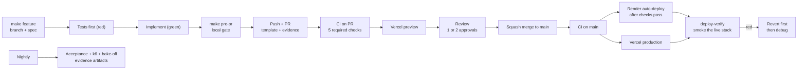
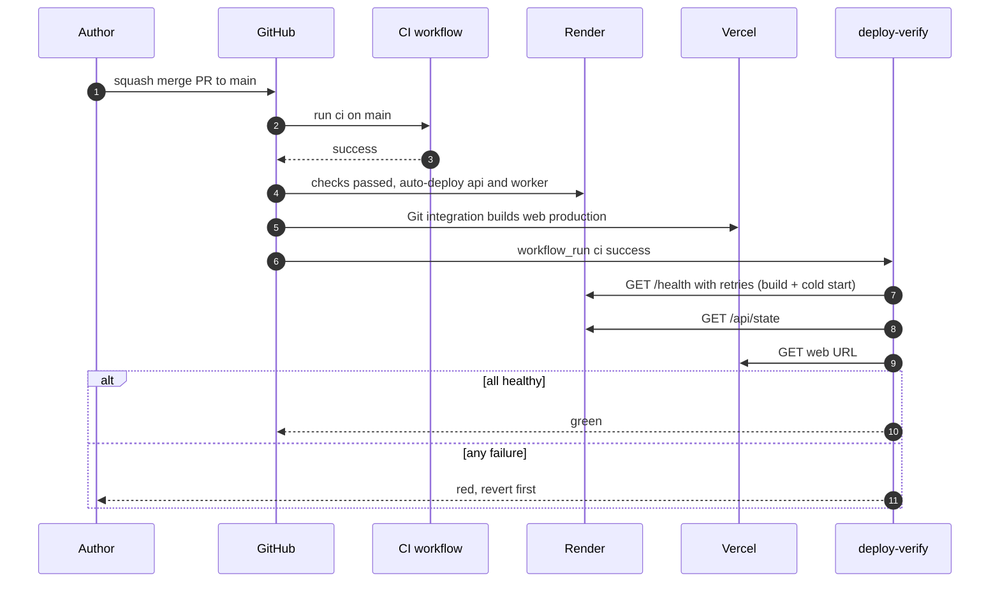

# PIPELINE — how we build, test, push, deploy and roll back

| | |
|---|---|
| **Status** | v1.0 · 2026-11-20 · lives at `docs/process/PIPELINE.md` |
| **Implements** | `FINAL_SYSTEM_DESIGN.md` D17–D21 on the colleague repo's layout |
| **Files** | `.github/workflows/{ci,nightly,deploy}.yml` · `scripts/{new-feature,pre-pr-check}.sh` · `.importlinter` · `requirements-ci.txt` · `deploy/render.yaml` · `deploy/k6/load.js` |
| **Verification status** | GitHub Actions PR run [45044716397](https://github.com/FardinAhmed-ScriptedSoul/Fuel-Supply-Intelligence-Resilience-Platform-FSIP-/actions/runs/45044716397) passed `backend`, `db-integration`, `frontend`, `security`, `compose-smoke`, and `e2e`. The Render blueprint and production deployment remain unverified; local Compose is blocked by the developer host's disk/Docker cache state. |

---

## 1. End-to-end flow

**Design rule:** the same checks run in three places — *locally* (`make pre-pr`), *on the PR* (CI), *after merge* (CI on `main` + deploy verification). A failure should never be a surprise at the last stage.

---

## 2. Stages

| # | Stage | Trigger | What runs | Budget | On failure |
|---|---|---|---|---|---|
| 0 | **Local gate** | `make pre-pr` / `pre-pr-fast` | branch-name + spec check, ruff, format, import-linter, unit+scenario, integration, security rules, pip-audit, gitleaks (if installed), web typecheck/test/build/audit, `docker compose config` | ≤ 5 min | don't open the PR |
| 1 | **backend** | PR, push to `main` | ruff + format · **import-linter** · unit+scenario tests with coverage | ≤ 3 min | block |
| 2 | **db-integration** | PR, push | Postgres **18** + real **simulator** services · apply `db.sql` · wait for `/v1/health` · `pytest tests/integration` | ≤ 6 min | block |
| 3 | **frontend** | PR, push | `npm ci` · typecheck · Vitest · build | ≤ 4 min | block |
| 4 | **security** | PR, push | gitleaks · ruff `S` rules · `pip-audit` (**temporary waiver**) · `npm audit` | ≤ 3 min | block (waiver expires with F-003) |
| 5 | **compose-smoke** | PR, push (after `backend`) | `docker compose up --build --wait` · `scripts/smoke.sh` · logs on failure · teardown | ≤ 10 min | block |
| 6 | **e2e** | PR, push (after smoke) | Playwright journeys (active because `web/e2e` exists) | ≤ 10 min | block |
| 7 | **Preview** | PR | Vercel preview deployment of `web/` | – | informational |
| 8 | **Deploy** | merge to `main` | Render builds after checks pass (`autoDeployTrigger: checksPass`) · Vercel production via Git integration | – | revert |
| 9 | **deploy-verify** | `ci` succeeds on `main` | wait for API/worker/web health · confirm `/api/state` answers | ≤ 15 min | alert; revert first |
| 10 | **Nightly evidence** | 20:00 UTC, manual | acceptance suite · k6 load · bake-off · artifacts uploaded | ≤ 45 min | report, fix next day |

The workflow currently runs **`backend`, `db-integration`, `frontend`, `security`, `compose-smoke`, and `e2e`** on PRs. Repository branch-protection settings were not independently inspected, so the list of enforced required checks remains unverified.

---

## 3. Test levels ↔ pipeline

| Level | Where it runs | Command |
|---|---|---|
| Unit | `backend` job, local gate | `make test-unit` |
| Integration | `db-integration` job (real PG 18 + real simulator), local gate | `make test-int` |
| E2E | `e2e` job on the compose stack | `make test-e2e` |
| Acceptance | `nightly` (full) and on-demand locally/CI with `ACCEPTANCE=1` | `make test-acc` |
| Architecture | `backend` job | `make lint-arch` |
| Security | `security` job | `make security` |
| Load | `nightly` | `make load` |

Determinism in CI: the simulator service starts **paused** with a fixed seed; tests drive time via `/admin/step` and reset via `/admin/reset`; no sleeps.

---

## 4. Environments

| Environment | What | Source | Notes |
|---|---|---|---|
| **local** | `docker compose up` (simulator, **Postgres 18**, api, worker, predictor, web, Prometheus, Grafana) | working tree | canonical runtime; judges run this against their own simulator image |
| **PR preview** | Vercel preview of `web/` | PR branch | points at the shared API (`VITE_API_URL`) — previews never get their own backend |
| **production (showcase)** | Vercel (web) + Render (api, worker, simulator, Postgres 18) | `main` | cloud limits below |
| **CI ephemeral** | GitHub runner with `services:` containers | PR / main | thrown away every run |

### Cloud constraints (from third-party 2026 pricing summaries — confirm on Render's own pages)
| Fact | Consequence for us |
|---|---|
| Free web services sleep after 15 min idle; ~1 min cold start | the always-polling worker stops → wake the stack **before** a demo, or pay |
| ~750 free instance-hours per workspace | at most about one always-on free service |
| Background workers have no free tier | the repo's worker exposes `/health`, so it can run as a **web** service |
| Free Postgres expires 30 days after creation; paid starts ≈ $6/mo | fine for the deadline, not beyond |
| Starter ≈ $7/mo per service, no sleep | api + worker + simulator + DB ≈ $27/mo for a no-sleep showcase |
**Decision needed from you (O3):** pay ≈ $27/mo, or free tier with "wake before demo" and compose as the graded runtime.

---

## 5. Configuration: secrets and variables

| Name | Where | Used by | Notes |
|---|---|---|---|
| `PROD_API_URL`, `PROD_WORKER_URL`, `PROD_WEB_URL` | GitHub **repo variables** | `deploy-verify` | unset ⇒ verification is skipped |
| `OPERATOR_TOKEN` | Render env (`sync: false`) | api | ≥ 32 random chars; never committed |
| `DATABASE_URL` | Render (from the database) | api, worker | never committed |
| `CORS_ORIGIN` | Render env | api | the Vercel URL |
| `VITE_API_URL` | Vercel env | web build | the Render API URL |
| `SIM_BASE_URL`, `PREDICTOR_URL`, `INGEST_INTERVAL_S`, `SIM_*` | Render / compose env | worker | names as in `.env.example` |
| LLM API key (if F-016) | Render env | worker | optional stretch; never in CI logs |
CI itself needs **no secrets** (compose uses `.env.example` placeholders; Postgres in CI uses a throw-away password).

---

## 6. Deploy and verify

**Vercel project settings:** root directory `web`; framework preset Vite; build `npm run build`; output `dist`; env `VITE_API_URL`. **Render:** create from `deploy/render.yaml` after reviewing every field (it is an untested skeleton); `OPERATOR_TOKEN` and `CORS_ORIGIN` set in the dashboard.
**Schema on boot:** local compose applies `db.sql` through `docker-entrypoint-initdb.d`; managed Postgres does not — F-012 must apply it idempotently at startup (or via a one-off `psql`).

---

## 7. Rollback runbook

| Situation | Action | Time |
|---|---|---|
| Bad merge broke `main` | **Revert the squash commit** (`git revert <sha>`, PR, fast-lane 2 approvals if needed); CI and deploy run again | ≈ 10 min |
| Bad Render deploy | Render dashboard → service → **Rollback** to the previous deploy; then revert in Git so `main` matches | ≈ 2 min |
| Bad Vercel deploy | Vercel → Deployments → **Instant Rollback** to the previous production deployment; then revert in Git | ≈ 1 min |
| Bad schema change | Schema changes are **additive and idempotent**, so rolling the code back is safe; never drop/rename in the same release | – |
| Corrupt local state | `make down`; `docker compose down -v` **only** with explicit approval (it deletes local DB/Grafana data); `make up` | – |
| Simulator in a weird state | `make sim-reset` (deterministic wipe) or restart the simulator container | – |
Rule: **revert first, debug second.** After any rollback add a note to `docs/PROGRESS.md`.

---

## 8. Caching, speed, and flake policy
- `actions/setup-python` / `setup-node` caches keyed on `requirements*.txt` / `web/package-lock.json`; `concurrency` cancels superseded runs.
- Jobs run in parallel; only `compose-smoke` waits for `backend`, `e2e` waits for `compose-smoke`.
- **Flaky test = defect.** Re-run once to confirm; fix or delete with an ADR; never retry-until-green and never `skip`.
- Coverage is uploaded as an artifact and reported in the log (baseline 82 %; ratchet per plan §4.4).

---

## 9. Pipeline decisions

| Decision | Why | Alternative |
|---|---|---|
| GitHub Actions | repo already uses it; native Vercel/Render hooks | Jenkins/GitLab — extra infrastructure for no gain |
| Render deploys itself (`checksPass`), Actions only **verifies** | avoids two systems fighting over deploys; deploy waits for green CI | Actions-driven deploy hooks — more secrets, more failure modes |
| Real Postgres 18 + real simulator as `services:` | proves schema/PG18 compatibility and simulator contract, not mocks | mocks only — misses real incompatibilities |
| gitleaks via its container image | the Action requires a license for organizations | gitleaks-action |
| `pip-audit` temporarily `continue-on-error` | baseline has 14 advisories; a red `main` on day 1 would stall the team | block immediately — correct, but unworkable until F-003 |
| `workflow_run` for verification | runs only after CI succeeded on `main` | cron polling |
| No image registry in v1 | Render builds from the repo; fewer moving parts | GHCR publish — add if we need immutable artifacts |
